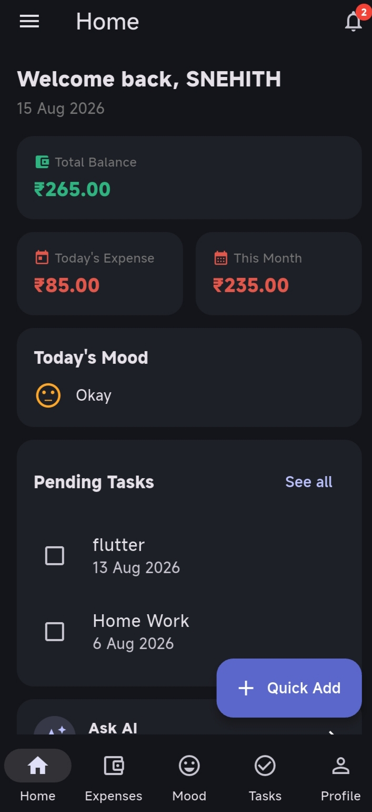
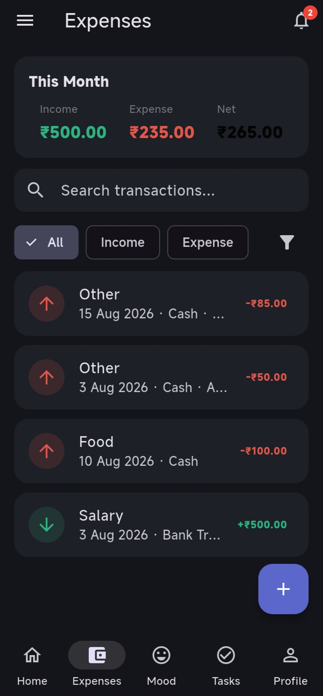
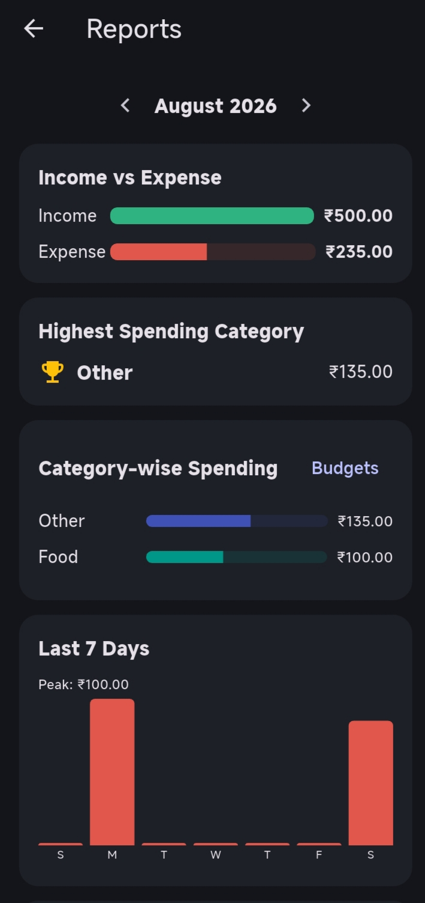
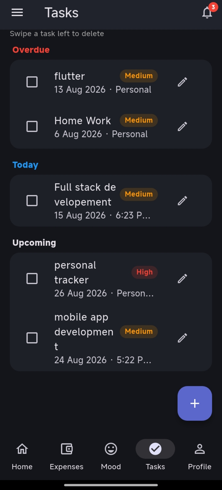
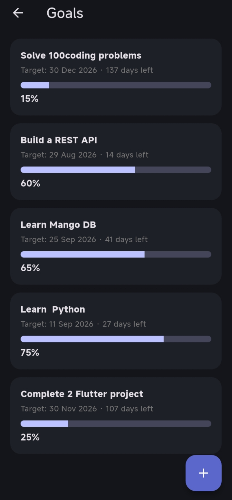

# Personal Tracker

**An all-in-one personal expense, mood, task, and goal tracker — built with Flutter.**

Track your money, your mood, your to-dos, and your goals in one clean, offline-first app. No account, no backend, no ads — everything lives on your device, and an optional AI assistant is built right in for when you just need to ask something.

<!--
  SCREENSHOTS: replace the placeholder paths below with your own images.
  1. Create a `screenshots/` folder in the project root.
  2. Add your PNG/JPG files there (e.g. screenshots/home.png).
  3. Keep the same filenames used below, or update the paths to match yours.
  Recommended: portrait phone screenshots, ~1080x2400, PNG.
-->

## Screenshots

| Home | Expenses | Reports |
|---|---|---|
|  |  |  |

| Mood Tracker | Tasks | Goals |
|---|---|---|
|  |  |  |

| Calendar | Ask AI | Settings |
|---|---|---|
|  |  |  |

<p align="center">
  
</p>

## Table of Contents

- [Features](#features)
- [Tech Stack](#tech-stack)
- [Getting Started](#getting-started)
- [Project Structure](#project-structure)
- [Key Packages](#key-packages)
- [Troubleshooting](#troubleshooting)
- [Roadmap Ideas](#roadmap-ideas)

## Features

### Money
- Add income & expenses with custom categories, payment method (Cash/Card/UPI/Bank/Other), and notes
- Recurring transactions (weekly/monthly) that auto-log themselves
- Category budgets with over-budget warnings
- Reports: income vs. expense, category breakdown, spending trend chart, weekly summary
- CSV export and full JSON backup/restore (copy-paste based — works across devices, no cloud account needed)

### Mood
- Daily mood check-in with a tappable calendar — log or edit *any* day, not just today
- Monthly mood summary and a nudge banner for days you haven't logged

### Tasks & Goals
- Tasks with due date + time, category, priority, checklists (sub-tasks), and repeat (daily/weekly/monthly)
- Goals with a target date, progress slider, and a "days left / overdue" indicator
- A Reminders screen that covers *every* task — overdue, upcoming, and even ones with no due date
- A blameless review for overdue tasks, with a supportive blocker check-in and an optional two-day smaller-step plan that does not reset streaks

### Notes & Calendar
- Quick notes with pinning and search
- A unified calendar view showing expenses, tasks, mood, goals, and notes for any day

### Cloud backup
- Optional Supabase email/password account with per-user Row Level Security
- Enter the Supabase project URL and public anon/publishable key in Cloud Sync; the app never needs a database password or service-role key
- Explicit upload and restore actions keep local storage usable offline; restoring replaces local records and requires confirmation
- Supabase auth sessions are stored using the platform's secure storage

### Ask AI
- A built-in chat assistant (bring your own OpenAI API key) for quick questions, right inside the app
- Optional AI personalization adds only a rolling 30-day aggregate of tracker totals and counts to the prompt when explicitly enabled in Settings; raw notes, merchants, transaction descriptions, and task titles are excluded
- Personalization changes the prompt context; it does not train or fine-tune model weights. Personal tracker summaries are sent directly to OpenAI only when this opt-in is enabled

### Focus & Energy
- Optionally log any known daily signal; unreported values remain unknown and are excluded from comparisons rather than treated as zero/default
- Show signal associations only when each comparison has enough observations; these are personal correlations, not causal or medical conclusions
- Estimate a 0–100 daily capacity from the logged sleep, meeting, high-priority task, and workout load, with the calculation shown in the app
- Present mode summarizes today's tracked alerts, offers a cautious next-day planning estimate, and answers local questions about logged mood, exercise, water, tasks, and cash flow
- Review and import normalized daily-signal CSV or JSON records; imports merge only provided fields and preserve other saved values
- Use the microphone to dictate a natural-language entry and review the extracted water, exercise, expense, and mood items before saving; the lightweight parser does not save the transcript, and assumes 250 ml per glass/cup
- Speech recognition is provided by the device/platform service; offline availability depends on the device and its speech service. The app does not save audio recordings.

Present mode currently uses only data already stored on the device. It does not read email or connect to Google Calendar, Plaid, Apple Health, or Health Connect. Live provider sync requires separate OAuth/provider configuration and explicit user authorization; no provider credentials are bundled in the app.

### Extras
- Dark mode, PIN app lock, global search, birthday/age tracking, daily streak, motivational quotes, a "Welcome-Back Summary" popup that surfaces anything needing attention when you open the app

## Tech Stack

- **Flutter** (Dart) — cross-platform UI
- **State management:** a lightweight custom `InheritedNotifier` (`AppScope`) — no external state package
- **Storage:** `shared_preferences` (local JSON), fully offline
- **Optional cloud backup:** Supabase Auth + a private JSONB backup row, protected by PostgreSQL Row Level Security
- **AI:** OpenAI Chat Completions API via `http` (user-supplied API key)
- **Voice input:** `speech_to_text` using the device's speech-recognition service

Microphone permission is requested only when starting voice input. The device's speech-recognition service may require network access; voice input is optional.

## Getting Started

### Prerequisites
- [Flutter SDK](https://docs.flutter.dev/get-started/install) (stable channel)
- A connected device, emulator, or desktop/web target

### Installation

```bash
# macOS/Linux
chmod +x setup.sh && ./setup.sh

# Windows (PowerShell)
.\setup.ps1
```

Or manually:

```bash
flutter create .
flutter pub get
flutter run
```

`flutter create .` generates the platform folders (`android/`, `ios/`, `web/`, etc.) around the existing source — it won't touch anything in `lib/`.

### Optional Supabase cloud backup

1. Create a Supabase project and open its SQL Editor.
2. Run [`supabase/migrations/20261030000000_user_backups.sql`](supabase/migrations/20261030000000_user_backups.sql) to create the owner-only backup table and RLS policy.
3. In the app, open **Settings → Cloud sync** and paste the project's HTTPS URL and public anon/publishable key from **Project Settings → API**.
4. Create an account or sign in with email/password. If email confirmation is enabled, confirm the account before signing in.
5. Choose **Upload this device** or **Restore cloud backup**. Upload replaces that account's previous snapshot. Restore replaces local tracker records; export a local backup first if you need to preserve them.

The app stores one versioned JSON backup per authenticated user, not separate queryable database rows for every record. Row Level Security checks `auth.uid()` on all operations. Sync is manual so the app never silently resolves conflicts or uploads newly logged records. The Supabase URL and public key are stored in this device's preferences; auth sessions use platform secure storage. Never use a database connection string, database password, service-role key, or other secret in the client. A public key alone does not grant access to another user's backup.

## Project Structure

```
lib/
  main.dart                  # App entry, navigation shell, startup logic
  theme.dart                 # Light/dark Material 3 themes
  models/                    # Transaction, MoodEntry, Task, Note, Goal, daily signals, ChatMessage
  services/
    storage_service.dart     # SharedPreferences read/write helpers
    app_state.dart            # Single source of truth (ChangeNotifier)
    supabase_sync_service.dart # Optional, explicit per-user cloud backups
    app_scope.dart            # InheritedNotifier so any screen can read state
    ai_service.dart           # OpenAI API integration
    focus_insights_service.dart # Transparent capacity estimate and signal comparisons
  screens/                   # One file per screen (Home, Expenses, Insights, Recovery, ...)
  widgets/                   # Reusable UI components
  utils/formatters.dart      # Date/money formatting helpers
```

## Key Packages

| Package | Purpose |
|---|---|
| `shared_preferences` | Local JSON persistence for all data |
| `intl` | Date/number formatting |
| `uuid` | Generating unique IDs for records |
| `path_provider` | Locating a writable directory for CSV/backup export |
| `http` | Calling the OpenAI API for the "Ask AI" chat feature |
| `speech_to_text` | Optional microphone-based speech recognition for quick logs |
| `supabase_flutter` | Optional Supabase authentication and manual backup sync |
| `flutter_secure_storage` | Secure persistence for Supabase auth sessions |

That's the complete dependency list — deliberately small, to keep the app easy to build and maintain.

## Troubleshooting

Ran into a build error? A few environment-specific issues (unrelated to the app's code) have come up before — see [`TROUBLESHOOTING.md`](TROUBLESHOOTING.md) for solutions to:
- Kotlin/Gradle errors after changing package versions (stale lockfile)
- A Kotlin compiler crash on Windows when the project and Flutter SDK are on different drive letters
- Where to find and share the exact error output if something new comes up

## Roadmap Ideas

- Swap `shared_preferences` for `sqflite` for larger datasets
- Richer charts via `fl_chart`
- Real OS push notifications (`flutter_local_notifications`) as an opt-in
- Automatic SMS reading (`flutter_sms_inbox`) as an opt-in, alongside the current paste-based flow
- Biometric app lock (`local_auth`) alongside the PIN

---

Built with Flutter.
